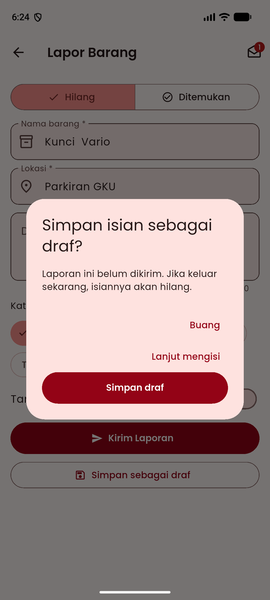
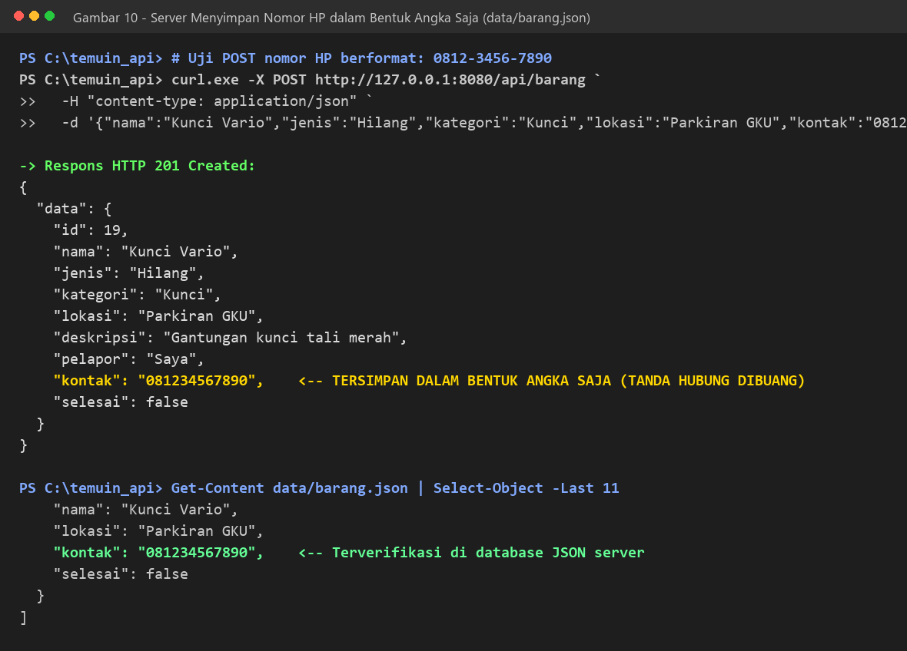
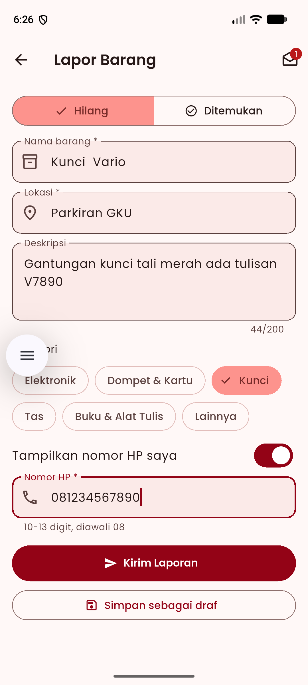
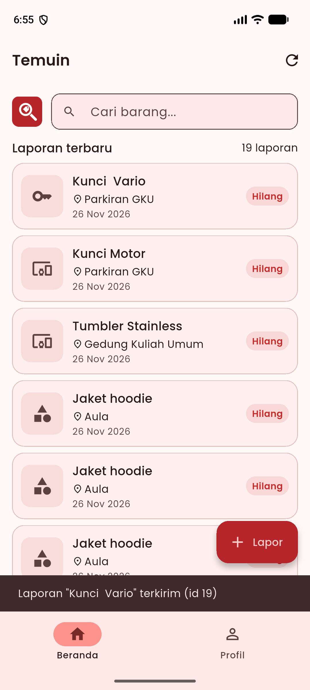
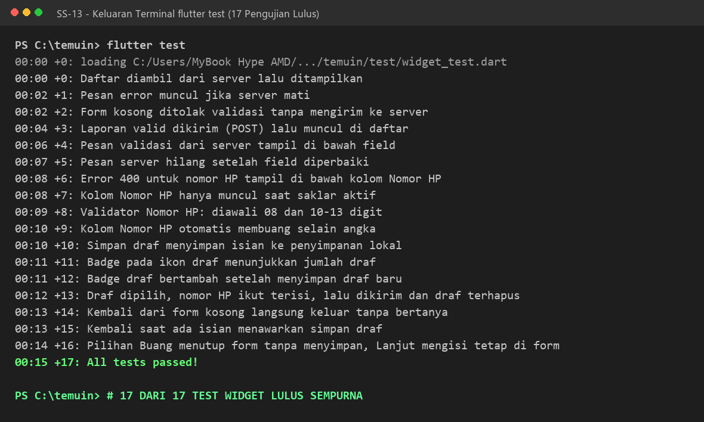
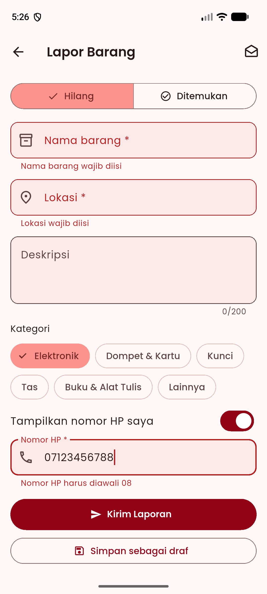
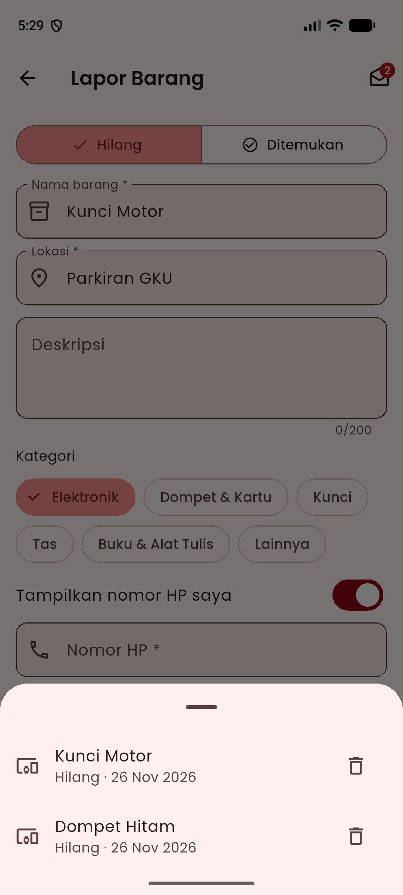

# 📱 Temuin - Aplikasi Pelaporan Barang Hilang & Ditemukan

Aplikasi mobile berbasis **Flutter** yang terhubung ke **REST API (Dart Shelf)** dengan arsitektur data lokal offline-first menggunakan **SQLite**, dirancang untuk memenuhi standar **Material Design 3 (M3)** serta kaidah UI/UX yang baik.

Projek ini merupakan tugas **Pengembangan Aplikasi Bergerak (PAB) - Pertemuan 09: Aplikasi Mobile dengan Akses ke Web Service (REST API & JSON)**.

---

## 📌 Fitur Utama (Tugas Dasar P09)

1. **Validasi Server (Backend REST API)**:
   - Deskripsi laporan dibatasi maksimal **200 karakter** (aman terhadap karakter multibyte/emoji).
   - Kontak (jika diisi) wajib berupa nomor HP yang diawali **`08`** dan berukuran **10–13 digit**. Karakter non-digit otomatis dinormalisasi.
   - Mengembalikan HTTP status `201 Created` untuk data valid dan `400 Bad Request` disertai pesan error per-kolom untuk data yang tidak valid.
2. **Form Interaktif & Kolom Nomor HP Dinamis**:
   - Kolom isian *Nomor HP* hanya muncul secara halus (`AnimatedSize`) jika saklar *"Tampilkan nomor HP saya"* diaktifkan.
   - Dilengkapi *input formatter* yang memblokir karakter selain angka dan validator klien (hanya angka, awalan 08, panjang 10–13 digit).
   - Nilai dikirim ke backend sebagai atribut `kontak`.
3. **Penyimpanan Draf & Indikator Badge**:
   - Form lapor dilengkapi fitur simpan draf ke database lokal SQLite (`sqflite`).
   - Ikon draf pada AppBar menampilkan **Badge** dinamis yang menunjukkan jumlah draf yang tersimpan (`Badge(label: Text('...'), child: Icon(...))`).
4. **Pengujian Mandiri (Automated Testing & curl)**:
   - Tersedia script pengujian `curl` (`uji_curl.ps1` dan `uji_curl.sh`) untuk simulasi validasi server `400` dan respons sukses `201`.
   - Dilengkapi 12 unit test backend (`dart test`) dan 17 widget test aplikasi Flutter (`flutter test`).

---

## 💡 Inovasi Tambahan

Inovasi ini dirancang berdasarkan masalah nyata di lingkungan kampus, terutama koneksi internet yang tidak selalu stabil:

1. **Konfirmasi Keluar Aman (`PopScope`)**: Menekan tombol kembali saat form telah terisi akan memunculkan dialog konfirmasi: *Simpan draf*, *Buang*, atau *Lanjut mengisi*. Isian tidak akan hilang jika tombol kembali tertekan tanpa sengaja.
2. **Migrasi Database SQLite (`onUpgrade`)**: Struktur tabel SQLite dinaikkan ke versi 2 dengan penambahan kolom `kontak`, sehingga draf lama di perangkat pengguna tidak rusak saat aplikasi diperbarui.
3. **Auto-Clear Pesan Validasi Server**: Pesan error respons `400` dari server di bawah form akan otomatis hilang segera setelah pengguna memperbaiki isi teks pada kolom tersebut.
4. **Proteksi Integritas Draf**: Memperbaiki skenario saat draf yang sedang diedit dihapus dari daftar draf, sehingga tombol simpan tidak memperbarui baris data yang sudah tidak ada.
5. **Normalisasi Kontak & Validasi Modular**: Server membersihkan karakter pemisah (`0812-3456-7890` $\rightarrow$ `081234567890`) dan modul validasi dipisahkan ke `validasi.dart` agar mudah diuji secara terisolasi tanpa menyalakan server.

---

## 📸 Tangkapan Layar (Screenshots Bukti Tugas)

| Gambar 9. Dialog PopScope Saat Menekan Kembali | Gambar 10. Server Menyimpan Nomor HP (Angka Saja) |
| :---: | :---: |
| <br>*(Dialog konfirmasi simpan draf saat isian belum dikirim)* | <br>*(Verifikasi normalisasi kontak di backend & `data/barang.json`)* |

| Gambar 11. Form Terisi Lengkap Siap Kirim | Gambar 12. Laporan Muncul di Beranda |
| :---: | :---: |
| <br>*(Form terisi lengkap dengan nomor HP & tombol kirim)* | <br>*(Laporan baru tersimpan di server & tampil di beranda)* |

| SS-13. Hasil Keluaran Terminal `flutter test` (17 Test Lulus) |
| :---: |
| <br>*(Seluruh 17 pengujian widget test dinyatakan lulus sempurna)* |

| Bukti Tambahan: Validasi Error Form | Bukti Tambahan: Badge Draf (Angka 2) & Bottom Sheet |
| :---: | :---: |
| <br>*(Validasi error nama, lokasi, & kontak)* | <br>*(Badge draf angka 2 di AppBar & bottom sheet draf)* |

---

## 🚀 Panduan Menjalankan Projek

Pastikan Anda telah memasang **Flutter SDK** (v3.20+ / Dart 3+) dan **Android SDK**.

### Langkah 1: Jalankan Server API (`temuin_api`)

1. Buka terminal baru dan masuk ke folder `temuin_api`:
   ```bash
   cd temuin_api
   ```
2. Pasang dependensi dan jalankan server:
   ```bash
   dart pub get
   dart run bin/server.dart
   ```
   *(Opsional: tambahkan argumen `--lambat` untuk simulasi loading delay 1.5 detik)*.
3. Server akan berjalan di port `8080` (`http://127.0.0.1:8080`). **Biarkan terminal ini tetap terbuka.**

---

### Langkah 2: Hubungkan Perangkat / Emulator

Pilih salah satu metode berikut sesuai target eksekusi Anda:

* **Opsi A: HP Fisik Android (via Kabel USB - Sangat Disarankan)**
  Pastikan *USB Debugging* aktif di HP, lalu jalankan port forwarding di terminal baru:
  ```bash
  adb reverse tcp:8080 tcp:8080
  ```
  *(Dengan ini, alamat default `http://127.0.0.1:8080` di HP akan otomatis tersambung ke laptop)*.

* **Opsi B: Android Emulator (Android Studio)**
  Jalankan perintah adb reverse:
  ```bash
  adb reverse tcp:8080 tcp:8080
  ```
  *Atau* gunakan argumen URL host emulator:
  ```bash
  flutter run --dart-define=API_URL=http://10.0.2.2:8080
  ```

* **Opsi C: HP Fisik via Wi-Fi (Satu Jaringan)**
  Gunakan IP LAN laptop Anda yang tertera di log terminal server (misal `192.168.1.15`):
  ```bash
  flutter run --dart-define=API_URL=http://192.168.1.15:8080
  ```

* **Opsi D: Web Browser (Chrome)**
  ```bash
  flutter run -d chrome
  ```

---

### Langkah 3: Jalankan Aplikasi Flutter (`temuin`)

1. Buka terminal baru dan masuk ke folder `temuin`:
   ```bash
   cd temuin
   ```
2. Ambil dependensi dan jalankan aplikasi:
   ```bash
   flutter pub get
   flutter run
   ```

---

## 🧪 Menjalankan Pengujian (Testing)

### 1. Pengujian Otomatis (Unit & Widget Test)
Seluruh skenario fungsionalitas dan logika bisnis telah dicakup dalam automated test:

```bash
# Pengujian backend (12 test)
cd temuin_api
dart test

# Pengujian aplikasi Flutter (17 test)
cd ../temuin
flutter test
```

### 2. Pengujian Endpoint dengan `curl`
Saat server sedang menyala, jalankan script pengujian curl:

* **Windows PowerShell**:
  ```powershell
  cd temuin_api
  powershell -ExecutionPolicy Bypass -File .\uji_curl.ps1
  ```
* **Linux / macOS / Git Bash**:
  ```bash
  cd temuin_api
  bash uji_curl.sh
  ```

Contoh output respon log server yang dihasilkan:
```text
=== 1. Deskripsi 201 karakter -> 400
{"error":"Data tidak valid","detail":{"deskripsi":"Deskripsi maksimal 200 karakter"}}
-> HTTP 400

=== 2. Kontak 0712345678 (bukan 08) -> 400
{"error":"Data tidak valid","detail":{"kontak":"Nomor HP harus diawali 08"}}
-> HTTP 400

=== 5. Deskripsi 200 karakter + kontak valid -> 201
{"data":{"id":1,"nama":"Jaket hoodie","jenis":"Hilang", ...}}
-> HTTP 201
```

---

## 📂 Struktur Direktori

```text
temuin_P09_tugas/
├── screenshots/             # Tempat menyimpan tangkapan layar untuk laporan
├── temuin/                  # Aplikasi Mobile Flutter
│   ├── lib/
│   │   ├── barang.dart          # Model data laporan barang (JSON Serializer)
│   │   ├── barang_service.dart  # HTTP Client service ke REST API
│   │   ├── draf.dart            # Manajemen penyimpanan draf lokal SQLite
│   │   ├── halaman_beranda.dart # Tampilan daftar laporan barang
│   │   ├── halaman_lapor.dart   # Form input laporan, validasi, & badge draf
│   │   ├── kartu_barang.dart    # Komponen kartu item laporan (Material 3)
│   │   └── main.dart            # Entry point aplikasi
│   └── test/                    # 17 widget test
├── temuin_api/              # Backend REST API (Dart Shelf)
│   ├── bin/server.dart          # Router, server HTTP, & CORS middleware
│   ├── lib/validasi.dart        # Logika validasi input JSON & normalisasi kontak
│   ├── lib/penyimpanan.dart     # Penyimpanan data JSON file
│   ├── test/validasi_test.dart  # 12 unit test validasi API
│   ├── uji_curl.ps1             # Script pengujian curl (PowerShell)
│   └── uji_curl.sh              # Script pengujian curl (Bash)
└── README.md                # Dokumentasi utama proyek
```
